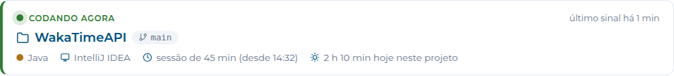
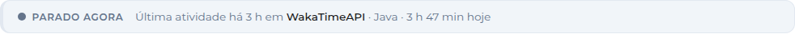

# Projeto WakaTimeAPI

Este projeto é uma integração com a API do WakaTime para exibir as estatísticas de tempo de programação de um usuário, feita com **Spring Boot** e **Thymeleaf**. O servidor chama a API do WakaTime com um token OAuth e o Thymeleaf monta a página, com o **mesmo visual do projeto React WakaTimeAPI**: a mesma faixa azul com a logo da PUC Minas, os mesmos cartões e o mesmo CSS.

O que a página mostra:

- **🟢 Codando agora**: projeto, branch, linguagem, editor e duração da sessão que está acontecendo agora (atualiza sozinho a cada minuto)
- **Indicadores**: tempo total, média diária, dias ativos, tempo de hoje e melhor dia
- **Barra de linguagens** (parte do todo) e **ranking** com tempo e porcentagem
- **Editores**, **sistemas operacionais** e **categorias** (programando, documentação, testes...)
- **Projetos** em que você mais trabalhou (pode ser escondido)
- **Botões de período**: 7 dias, 30 dias, 6 meses, 1 ano e desde sempre
- Avisos de **erro** (token faltando, inválido ou sem escopo) e de "WakaTime ainda calculando"

## 🖼️ Capturas de Tela

| Desktop | Celular |
| :---: | :---: |
|  |  |

> ⚠️ **Mudança no WakaTime (1º de novembro de 2026):** a API key do WakaTime não serve mais para **ler** dados. Este projeto usa um **token OAuth**, enviado no cabeçalho `Authorization: Bearer`. Veja [🔐 Token OAuth do WakaTime](#-token-oauth-do-wakatime).

## 🚀 Como rodar

1. Gere o token OAuth (passo a passo em [🔐 Token OAuth do WakaTime](#-token-oauth-do-wakatime)) e coloque no `application.properties`.
2. Na raiz do projeto, rode:

   ```bash
   ./mvnw spring-boot:run      # Linux/macOS
   mvnw.cmd spring-boot:run    # Windows
   ```

3. Acesse `http://localhost:8080`.

> Sem o token, a aplicação sobe normalmente, mas a página mostra o aviso **"Configure o wakatime.oauth.access-token..."**.

## Dependências:

No arquivo **pom.xml**, adicione a dependência do Thymeleaf para renderizar templates HTML:

```xml
<!-- Thymeleaf (para templates HTML) -->
<dependency>
    <groupId>org.springframework.boot</groupId>
    <artifactId>spring-boot-starter-thymeleaf</artifactId>
</dependency>
```

## 🔑 Conta e plugin do WakaTime

1. Crie uma conta gratuita em [wakatime.com/signup](https://wakatime.com/signup) (dá para entrar com o GitHub).
2. Instale o plugin do WakaTime no seu editor. No **VS Code**: aba **Extensions** → procure **WakaTime** → **Install**. No **IntelliJ IDEA**: **Settings** → **Plugins** → procure **WakaTime** → **Install**.
3. O editor vai pedir a **API key** na primeira vez. Ela está em [wakatime.com/settings/api-key](https://wakatime.com/settings/api-key).
4. Programe um pouco: o plugin manda os dados para o WakaTime enquanto você digita. As primeiras estatísticas aparecem no [dashboard](https://wakatime.com/dashboard) depois de alguns minutos.

> 💡 A **API key** continua existindo, mas agora ela é só do **plugin** (para **enviar** a atividade). Para o projeto **ler** os seus dados, você vai gerar um **token OAuth**, explicado logo abaixo. A API key **não** vai no `application.properties`.

## 🔐 Token OAuth do WakaTime

A página lê dados **privados** da sua conta, então precisa de autenticação. Quem chama o WakaTime é o `WakaTimeClient`, no servidor, com o token configurado no pacote `config` (classe `ApiConfig`). Um token só, gerado uma vez, serve para tudo:

| Escopo | Endpoint | Onde aparece |
|:--|:--|:--|
| `read_stats` | `GET /users/current/stats/{periodo}` | Indicadores, linguagens, editores, sistemas, categorias e projetos |
| `read_summaries` | `GET /users/current/status_bar/today` | Indicador **Hoje** (sem ele, aparece o editor principal no lugar) |
| `read_heartbeats` | `GET /users/current/heartbeats` e `/user_agents` | Cartão **🟢 Codando agora** |

### 🤔 Por que OAuth e não a API key?

O jeito mais simples de ler dados privados era mandar a API key na URL (`?api_key=...`) ou no cabeçalho (`Authorization: Basic <api key em base64>`), e era assim que este projeto funcionava. Isso vai acabar. O WakaTime avisou por e-mail:

> 📧 *"Starting November 1, 2026, WakaTime API keys will become write-only. They will only work in the WakaTime plugins for sending data and will no longer work for other API endpoints. Please transition your app, script, or integration to using OAuth tokens instead of API keys before November 1."*

Ou seja: **a partir de 1º de novembro de 2026**, a API key só serve para os plugins (VS Code, JetBrains etc.) enviarem a atividade de código. Qualquer leitura feita com ela responde erro, e a página pararia de funcionar. A saída indicada na [documentação de autenticação](https://wakatime.com/developers#authentication) é o **OAuth**.

E a troca também é mais segura. Pense assim:

- 🔑 **API key** é a chave da sua casa: abre todas as portas (lê e escreve tudo na conta) e, se vazar, a única saída é trocar a fechadura.
- 🪪 **Token OAuth** é um crachá de visitante que você mesmo emite: só abre as portas que você autorizou (os **escopos**; aqui, só leitura: `read_stats`, `read_summaries` e `read_heartbeats`) e pode ser revogado sem mexer na sua chave.

### 🔄 Como o OAuth funciona aqui

O projeto usa o fluxo *authorization code*, e o `scripts/WakaTimeOAuth.java` faz tudo sozinho:

1. Abre no navegador `wakatime.com/oauth/authorize` com o **App ID** e os escopos `read_stats`, `read_summaries` e `read_heartbeats`.
2. Você faz login e clica em **Authorize**.
3. O WakaTime redireciona para `http://localhost:8787/callback?code=...`, onde o script está escutando.
4. O script troca esse `code` (junto com o **App Secret**) em `wakatime.com/oauth/token` por dois tokens: o **access token** e o **refresh token**.
5. Daí em diante, o `WakaTimeClient` manda `Authorization: Bearer <access token>` em cada chamada (usado pelo `WakaTimeApiService` e pelo `CodingNowService`).

> 💡 O `scripts/WakaTimeOAuth.java` é um arquivo Java único: o próprio `java` (Java 11+) compila e roda, sem Maven e sem dependências. Ele fica fora do `src/` e não faz parte da aplicação Spring Boot.

### 🛠️ Passo a passo (uma vez só)

1. **Crie o app no WakaTime.** Em [wakatime.com/apps](https://wakatime.com/apps), crie um novo app e preencha:

   | Campo | O que colocar | Exemplo |
   |:--|:--|:--|
   | **Name** | Um nome para o app | `wakatime-api-spring` |
   | **Redirect URI** | Exatamente este endereço, onde o script recebe a autorização | `http://localhost:8787/callback` |
   | **Install URL** | O endereço do seu projeto. Se ainda não tiver um publicado, use o local | `http://localhost:8080` |
   | **Publisher Website** | O seu site | `https://seu-site.dev` |

   Ao salvar, a página do app mostra o **App ID** e o **App Secret**.

2. **Preencha o App ID e o App Secret** no `src/main/resources/application.properties`, trocando os `SEU_..._AQUI`:

   ```properties
   wakatime.oauth.app-id=seu-app-id
   wakatime.oauth.app-secret=seu-app-secret
   ```

3. **Gere os tokens.** Na raiz do projeto, rode:

   ```bash
   java scripts/WakaTimeOAuth.java
   ```

   O navegador abre a tela de autorização. Depois de clicar em **Authorize**, a aba mostra "Pronto!" e o terminal imprime as linhas:

   ```text
   Cole no application.properties:

   wakatime.oauth.access-token=...
   wakatime.oauth.refresh-token=...

   Escopo: read_stats,read_summaries,read_heartbeats  |  expira em: ...
   ```

4. **Cole as duas linhas no `application.properties`** (no lugar das que já existem), rode `./mvnw spring-boot:run` e abra `http://localhost:8080`. Se você estiver programando, o cartão **Codando agora** aparece em até um minuto.

> 🔁 **Já tinha gerado o token só com o `read_stats`?** Rode o script de novo e autorize os três escopos. Sem o `read_summaries`, o indicador "Hoje" vira "Editor principal"; sem o `read_heartbeats`, o cartão "Codando agora" não aparece.

> 💡 Se o navegador não abrir sozinho, o terminal imprime o link da autorização para você abrir na mão. Se aparecer erro de `redirect_uri`, confira se a URI do app é **exatamente** `http://localhost:8787/callback` (sem barra no final, `http` e não `https`).

> 💡 Se a página mostrar **"Sem permissão: o token precisa do escopo read_stats"**, rode o script de novo e autorize os escopos.

### ⚙️ `application.properties`

```properties
spring.application.name=WakaTimeAPI

wakatime.api.url=https://api.wakatime.com/api/v1/users/current

wakatime.oauth.access-token=SEU_ACCESS_TOKEN_AQUI
wakatime.oauth.app-id=SEU_APP_ID_AQUI
wakatime.oauth.app-secret=SEU_APP_SECRET_AQUI
wakatime.oauth.refresh-token=SEU_REFRESH_TOKEN_AQUI
wakatime.oauth.token-url=https://wakatime.com/oauth/token

wakatime.username=

wakatime.panel.default-range=all_time
wakatime.panel.profile-url=https://wakatime.com/@aramuni
wakatime.panel.max-languages=10
wakatime.panel.hidden-languages=
wakatime.panel.show-projects=true

wakatime.coding-now.timezone=America/Sao_Paulo
wakatime.coding-now.active-minutes=10
wakatime.coding-now.break-minutes=15
wakatime.coding-now.refresh-seconds=60
wakatime.coding-now.public-projects=*
wakatime.coding-now.show-private=true
```

Troque cada `SEU_..._AQUI` pelo valor real. Os valores que ainda estão como `SEU_..._AQUI` contam como vazios: a aplicação sobe normalmente e a página avisa o que falta.

| Propriedade | Obrigatória? | Para que serve |
|:--|:--:|:--|
| `wakatime.oauth.access-token` | ✅ | Token que o serviço manda no `Authorization: Bearer` |
| `wakatime.oauth.refresh-token` | Opcional | Pede um novo access token se o atual expirar ou for revogado |
| `wakatime.oauth.app-id` | Opcional | Usado na renovação e pelo `scripts/WakaTimeOAuth.java` |
| `wakatime.oauth.app-secret` | Opcional | Usado na renovação e pelo `scripts/WakaTimeOAuth.java` |
| `wakatime.username` | Opcional | Usuário com perfil público, usado só sem o token (ou se ele falhar). Veja [Alternativa sem token](#alternativa-sem-token-perfil-público) |

A renovação automática só funciona com as três opcionais juntas (`app-id`, `app-secret` e `refresh-token`).

As outras propriedades não são secretas:

| Propriedade | Padrão | O que faz |
|:--|:--|:--|
| `wakatime.panel.default-range` | `all_time` | Período aberto ao carregar a página (`last_7_days`, `last_30_days`, `last_6_months`, `last_year`, `all_time`) |
| `wakatime.panel.profile-url` | `https://wakatime.com/@aramuni` | Link do botão "Ver perfil no WakaTime" (vazio esconde o botão) |
| `wakatime.panel.max-languages` | `10` | Quantas linguagens aparecem na lista (o resto vira "+ N outras") |
| `wakatime.panel.hidden-languages` | vazio | Linguagens que não aparecem, ex.: `Text,Other` |
| `wakatime.coding-now.public-projects` | `*` | Projetos que aparecem pelo nome no "Codando agora", separados por vírgula (`*` = todos) |
| `wakatime.panel.show-projects` | `true` | `false` esconde os nomes dos projetos (projetos de cliente), no painel e no "Codando agora" |
| `wakatime.coding-now.timezone` | `America/Sao_Paulo` | Fuso da sua conta no WakaTime: é por ele que a API separa os dias |
| `wakatime.coding-now.active-minutes` | `10` | Último heartbeat há até 10 min = "codando agora" |
| `wakatime.coding-now.break-minutes` | `15` | Pausa maior que isso encerra a sessão |
| `wakatime.coding-now.refresh-seconds` | `60` | De quanto em quanto tempo a página pergunta de novo |
| `wakatime.coding-now.show-private` | `true` | `false`: projeto fora da lista nem aparece no cartão |

### ⏳ Validade

O access token gerado vale **100 anos** (a data aparece em "expira em", no terminal), então na prática o passo a passo é feito uma vez só. Se um dia a API responder `401` (por exemplo, se você revogar o acesso do app), o `WakaTimeApiService` usa o refresh token para pedir outro. Esse token novo fica só na memória da aplicação: para valer de vez, rode `java scripts/WakaTimeOAuth.java` de novo e atualize o `application.properties`.

### Alternativa sem token: perfil público

Se preferir não usar o token, deixe o seu perfil público em [wakatime.com/settings/profile](https://wakatime.com/settings/profile) (tempo de código, linguagens, editores e sistemas operacionais públicos) e preencha só o `wakatime.username`:

```properties
wakatime.username=seu_usuario
```

Aí o painel lê `GET /api/v1/users/seu_usuario/stats/{periodo}`, sem autenticação. A regra é **autenticar sempre que der**, para funcionar mesmo com o perfil privado:

| Situação | De onde vêm as estatísticas | O perfil precisa ser público? |
|:--|:--|:--:|
| Com o `access-token` | `/users/current/stats/{periodo}`, com `Authorization: Bearer` | Não |
| Sem o token, ou se ele falhar (inválido, sem o escopo `read_stats`), com o `username` | `/users/{username}/stats/{periodo}`, sem autenticação | Sim |
| Sem o token e sem o `username` | A página avisa o que configurar | — |

No perfil público, o indicador **Hoje** e o cartão **Codando agora** não aparecem (os dois usam dados privados), e o rodapé do painel diz "perfil público" em vez de "lidos com o seu token OAuth". Alguns períodos podem não estar disponíveis para visitantes: nesse caso a página mostra o aviso.

> ⚠️ Nunca faça commit do App Secret nem dos tokens. Antes de subir o projeto para o GitHub, confira se o `application.properties` voltou para `SEU_..._AQUI`.

## ⚙️ Como funciona

```text
Navegador ──GET /?range=last_7_days──────────▶  WakaTimeApiController → WakaTimeApiService
                                                         │  WakaTimeClient + Bearer token
                                                         ▼
                                    https://api.wakatime.com/api/v1/users/current/stats/last_7_days
                                    https://api.wakatime.com/api/v1/users/current/status_bar/today

Navegador ──GET /fragmentos/codando-agora──────▶  WakaTimeApiController → CodingNowService
          (static/js/codando-agora.js, a cada 1 min)     │  WakaTimeClient + Bearer token
                                                         ▼
                                    https://api.wakatime.com/api/v1/users/current/heartbeats?date=hoje
                                    https://api.wakatime.com/api/v1/users/current/user_agents
```

- O token **nunca vai para o navegador**: quem fala com o WakaTime é sempre o servidor (`WakaTimeClient`).
- Sem o token (ou se ele falhar), o painel usa o perfil público do `wakatime.username`, se estiver configurado (`/users/{username}/stats/{periodo}`, sem autenticação).
- O painel é montado pelo Thymeleaf (`templates/home.html`). Os botões de período são um formulário `GET`: cada um recarrega a página com `?range=...`.
- Cada período fica **10 minutos** em cache na memória: recarregar a página ou voltar a um período já aberto não chama o WakaTime de novo.
- O "Codando agora" é um fragmento do Thymeleaf (`templates/fragments/codando-agora.html`) que a página busca de novo a cada minuto. Ele fica **60 s** em cache: o token é usado no máximo uma vez por minuto, por mais visitantes que estejam com a página aberta.

### Exemplo de chamada à API

A requisição que o `WakaTimeClient` faz, com o token no cabeçalho. Para testar no terminal, substitua `seu_access_token` pelo seu token:

```bash
curl -H "Authorization: Bearer seu_access_token" \
  https://api.wakatime.com/api/v1/users/current/stats/all_time
```

No código (`service/WakaTimeClient.java`):

```java
HttpHeaders headers = new HttpHeaders();
headers.setBearerAuth(token);

restTemplate.exchange(apiConfig.getApiUrl() + path, HttpMethod.GET,
        new HttpEntity<>(headers), type);
```

## 🟢 Codando agora (projeto em construção no momento)

Acima dos botões de período aparece um cartão dizendo **em qual projeto você está programando agora**, com a branch, a linguagem, o editor, há quanto tempo a sessão começou e quanto tempo você já passou nesse projeto hoje:



Parado, ele vira uma linha discreta:



### De onde vem essa informação

A extensão do WakaTime no editor manda um **heartbeat** (um "sinal de vida") a cada ~2 minutos enquanto você digita. Cada heartbeat diz o **projeto** (em geral, o nome da pasta aberta), a **branch** do Git, a **linguagem**, o **editor** e o arquivo.

O `CodingNowService` faz o seguinte:

1. Busca os heartbeats de hoje em `GET /users/current/heartbeats?date=AAAA-MM-DD` (no fuso da sua conta).
2. Descarta os heartbeats que não são de arquivo (os de navegador trazem domínios visitados).
3. Olha o **último**: se chegou há até `active-minutes` (10 min), você está **codando agora**.
4. Volta pelos heartbeats até achar uma pausa maior que `break-minutes` (15 min, o mesmo timeout do WakaTime): ali começou a **sessão**.
5. Soma os intervalos entre heartbeats seguidos para calcular o tempo de hoje no projeto (é aproximado: o dashboard do WakaTime pode diferir em alguns minutos).
6. Troca o id do editor pelo nome (`GET /users/current/user_agents`, guardado por 1 hora).

A página pergunta de novo **a cada minuto** enquanto a aba está aberta (e na hora em que você volta para ela).

> 🔒 Heartbeats são **privados**: o cartão só funciona com o token com o escopo `read_heartbeats`. Sem ele, o endereço `/fragmentos/codando-agora` responde `204` e o cartão simplesmente não aparece.

### Privacidade

- O **caminho do arquivo** que você está editando **nem é lido**: o `model/Heartbeat` não tem o campo `entity`, e a resposta só leva projeto, branch, linguagem e editor.
- Por padrão todos os projetos aparecem pelo nome (`public-projects=*`). Para esconder **projetos de cliente**, troque por uma lista com os projetos que podem aparecer. Os outros viram **"projeto privado"** (sem nome e sem branch), ou somem de vez com `show-private=false`.
- `wakatime.panel.show-projects=false` esconde o nome do projeto no cartão e a lista de projetos do painel.

### Testando

Rode `./mvnw spring-boot:run`, abra qualquer projeto no editor (com a extensão do WakaTime) e digite por 1 ou 2 minutos. Em até um minuto o cartão fica verde com o nome do projeto. Para ver a resposta crua, acesse `http://localhost:8080/api/codando`:

```json
{
  "active": true,
  "todaySeconds": 15600,
  "last": {
    "isPublic": true,
    "project": "WakaTimeAPI",
    "branch": "main",
    "language": "Java",
    "editor": "IntelliJ IDEA",
    "at": 1791714685882,
    "sessionStart": 1791711985882,
    "projectTodaySeconds": 7800,
    "sessionSeconds": 2700
  }
}
```

## Estrutura do projeto:

```text
📁 WakaTimeAPI
│
├── 📁 imgs                        └── Capturas de tela usadas neste README
│
├── 📁 scripts
│   └── WakaTimeOAuth.java          └── Gera o access token e o refresh token (fora da aplicação)
│
├── 📁 src/main/java/com/example/WakaTimeAPI
│   ├── 📁 application
│   │   └── WakaTimeApiApplication  └── Classe principal e o bean do RestTemplate
│   ├── 📁 config
│   │   └── ApiConfig               └── URL da API, chaves do OAuth, username, painel e Codando agora
│   ├── 📁 controller
│   │   └── WakaTimeApiController   └── Página (/), fragmento do Codando agora e /api/codando
│   ├── 📁 model
│   │   ├── BestDay, Category, Data, Dependency, Editor, Language, Machine,
│   │   │   OperatingSystem, Project, WakaTimeApiResponse   └── Resposta das estatísticas
│   │   ├── Heartbeat, HeartbeatsResponse, UserAgent, UserAgentsResponse └── Codando agora
│   │   ├── StatsView, StatsItem    └── Estatísticas prontas para a página
│   │   └── CodingNow               └── "Codando agora" (página e JSON)
│   ├── 📁 service
│   │   ├── WakaTimeClient          └── GET com Authorization: Bearer e renovação do token (ou sem token, no perfil público)
│   │   ├── WakaTimeException       └── Token faltando, inválido ou sem escopo
│   │   ├── WakaTimeApiService      └── Estatísticas do período + "Hoje" (cache de 10 min), com o perfil público de reserva
│   │   └── CodingNowService        └── Heartbeats → codando agora (cache de 60 s)
│   └── 📁 util
│       └── WakaTimeFormat          └── Formatação pt-BR e cores das linguagens (@fmt nos templates)
│
├── 📁 src/main/resources
│   ├── application.properties      └── URL, chaves do OAuth, painel e Codando agora
│   ├── 📁 static
│   │   ├── css/style.css           └── O mesmo CSS do projeto React (index + PageLayout + WakaTimeStats)
│   │   ├── js/codando-agora.js     └── Atualiza o "Codando agora" a cada minuto
│   │   └── images/pucminas-logo.png
│   └── 📁 templates
│       ├── home.html               └── Página com o painel
│       └── 📁 fragments
│           ├── codando-agora.html  └── Cartão "Codando agora"
│           └── icons.html          └── Ícones (Feather Icons, os mesmos do react-icons)
│
└── 📄 pom.xml
```

## Endpoints:

| Endereço | O que devolve |
|:--|:--|
| `GET /` | A página com o painel (período padrão) |
| `GET /?range=last_7_days` | A página com outro período (`last_7_days`, `last_30_days`, `last_6_months`, `last_year`, `all_time`) |
| `GET /fragmentos/codando-agora` | O cartão "Codando agora" em HTML (`204` sem token ou sem `read_heartbeats`) |
| `GET /api/codando` | O mesmo "Codando agora" em JSON |

O endpoint da página, responsável por pegar as estatísticas do WakaTime e renderizar os dados no HTML:

```java
@GetMapping("/")
public String home(@RequestParam(required = false) String range, Model model) {
    String selected = wakaTimeApiService.validRange(range);
    model.addAttribute("range", selected);
    model.addAttribute("ranges", WakaTimeApiService.RANGES);
    try {
        StatsView stats = wakaTimeApiService.getStats(selected);
        model.addAttribute("stats", stats);
    } catch (WakaTimeException e) {
        // Token faltando, inválido ou sem o escopo read_stats
        model.addAttribute("erro", e.getMessage());
    }
    return "home";
}
```

(Versão resumida: o controller também trata o "WakaTime ainda está calculando" e falhas de rede.)

## Dados da Consulta da API

A consulta de estatísticas (`/stats/{periodo}`) retorna os seguintes dados. O `WakaTimeApiService` usa parte deles para montar o `StatsView` da página:

- **best_day**: O melhor dia de atividade registrado.
- **categories**: Lista de categorias relacionadas à atividade de programação.
- **created_at**: Data de criação dos dados.
- **daily_average**: Média diária de tempo gasto em programação.
- **daily_average_including_other_language**: Média diária de tempo gasto em programação, incluindo outras linguagens.
- **days_including_holidays**: Número de dias incluindo feriados.
- **days_minus_holidays**: Número de dias excluindo feriados.
- **dependencies**: Lista de dependências utilizadas nos projetos.
- **editors**: Lista de editores de código usados.
- **end**: Data de término do período de dados.
- **holidays**: Número de feriados registrados.
- **human_readable_daily_average**: Média diária formatada de forma legível.
- **human_readable_daily_average_including_other_language**: Média diária, incluindo outras linguagens, formatada de forma legível.
- **human_readable_range**: Intervalo de tempo formatado de forma legível.
- **human_readable_total**: Total de tempo gasto em programação, formatado de forma legível.
- **human_readable_total_including_other_language**: Total de tempo, incluindo outras linguagens, formatado de forma legível.
- **id**: Identificador único dos dados.
- **is_already_updating**: Indica se os dados estão sendo atualizados.
- **is_cached**: Indica se os dados são armazenados em cache.
- **is_coding_activity_visible**: Indica se a atividade de programação está visível.
- **is_including_today**: Indica se o dia de hoje está incluído nos dados.
- **is_other_usage_visible**: Indica se o uso de outras atividades está visível.
- **is_stuck**: Indica se a consulta está travada.
- **is_up_to_date**: Indica se os dados estão atualizados.
- **is_up_to_date_pending_future**: Indica se os dados estão pendentes de atualização futura.
- **languages**: Lista de linguagens utilizadas nos projetos.
- **machines**: Lista de máquinas utilizadas.
- **modified_at**: Data de modificação dos dados.
- **operating_systems**: Lista de sistemas operacionais utilizados.
- **percent_calculated**: Percentual de dados calculados.
- **projects**: Lista de projetos realizados.
- **range**: Intervalo de tempo da consulta.
- **start**: Data de início do período de dados.
- **status**: Status da consulta.
- **timeout**: Tempo limite da consulta.
- **timezone**: Fuso horário utilizado.
- **total_seconds**: Total de segundos registrados de atividade.
- **total_seconds_including_other_language**: Total de segundos de atividade, incluindo outras linguagens.
- **user_id**: Identificador do usuário.
- **username**: Nome de usuário.
- **writes_only**: Indica se o usuário só faz escrita (sem leitura).

## Documentação e links úteis:

- [API Docs](https://wakatime.com/developers)
- [Autenticação (OAuth)](https://wakatime.com/developers#authentication)
- [Apps OAuth (App ID e App Secret)](https://wakatime.com/apps)
- [API key (só para o plugin do editor)](https://wakatime.com/settings/api-key)

## Licença:

Este projeto está licenciado sob a MIT License.
